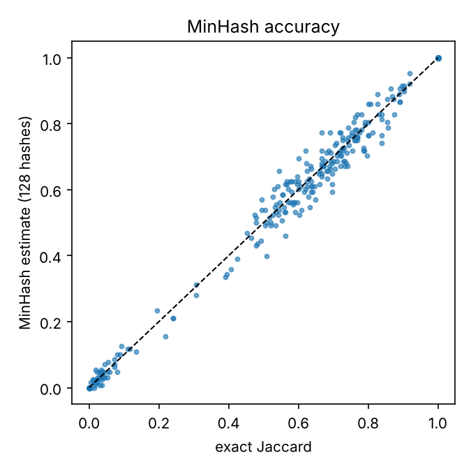
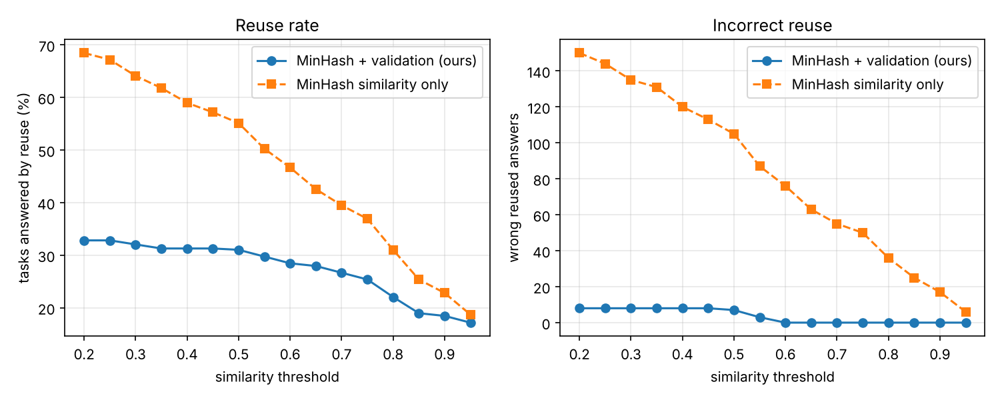
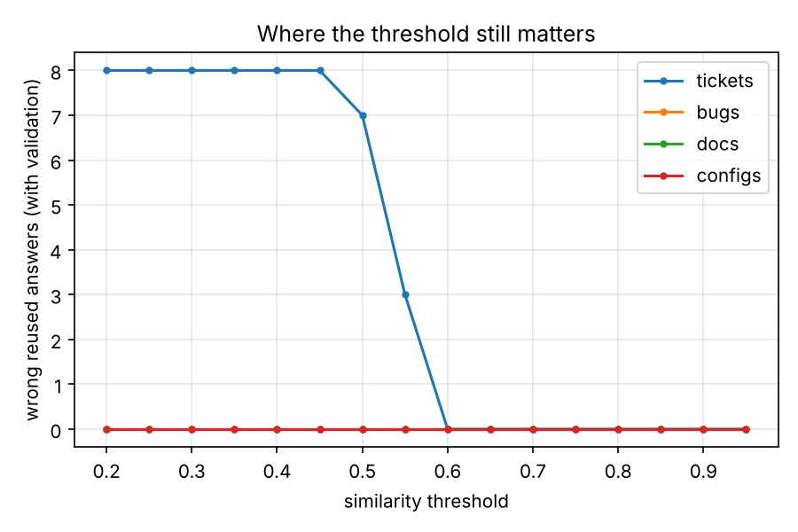
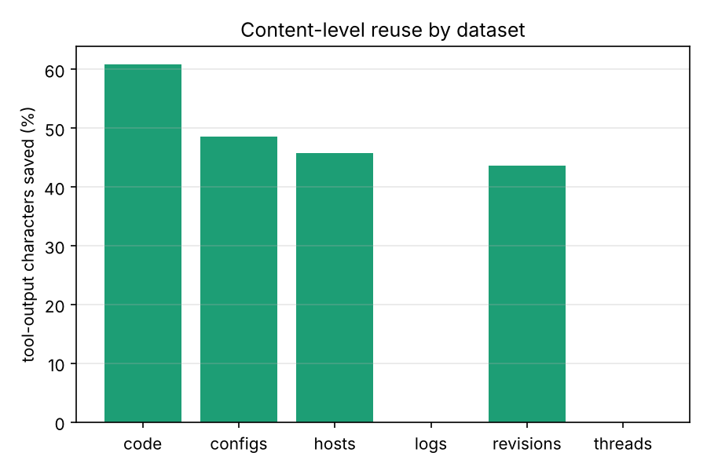
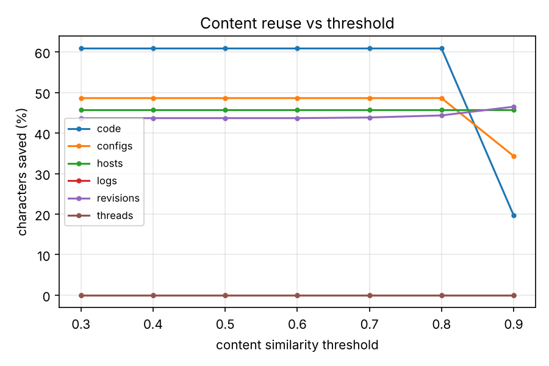
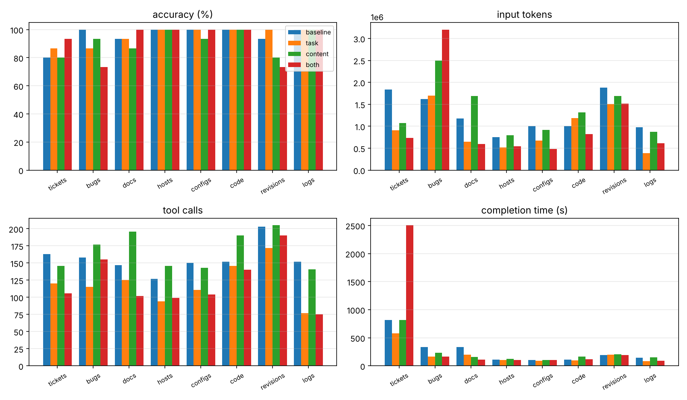
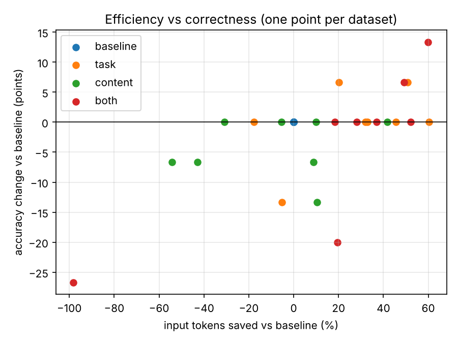
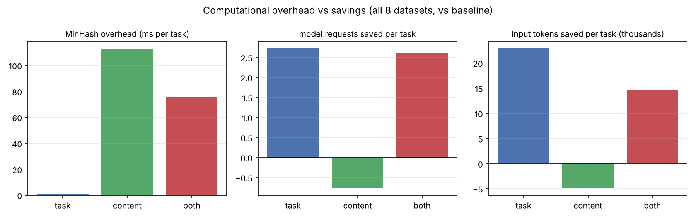

# MinHash for Efficient Agent Trajectories (COMP 480/580, Assignment 2)

Aneesha Nayak

## 1. Methodology

**MinHash and LSH (`minhash.py`).** A text is lower-cased and split into alphanumeric words. Each three-word shingle is mapped to a stable 64-bit integer with BLAKE2b, then pushed through 128 random linear hash functions h_i(x) = (a_i x + b_i) mod (2^61 − 1). The parameters come from a fixed seed (580). The signature keeps the minimum of each h_i, and the fraction of matching positions estimates Jaccard similarity. Over 400 pairs, the mean absolute error against exact Jaccard is **0.018** (figure below)


. For lookup, the 128 values are split into 32 bands of 4 rows. Two items become candidates if any band matches, which happens with probability 1 − (1 − J⁴)³². That curve is steep around J ≈ 0.42, so near-duplicates are almost always retrieved and unrelated records are almost never compared.

**Task-level reuse (`policy.py`).** A reuse needs three gates to pass. Refusing is always safe: the agent just runs.

1. **Retrieve.** LSH over the verified records: `history.jsonl` plus new answers indexed only after `verify.py` passes.
2. **Similarity.** The estimated Jaccard must be at least a per-dataset threshold.
3. **Validate.** The candidate's *visible key* must equal the task's key after normalization. The visible key is the structured fields that each dataset's `INSTRUCTIONS.md` says decide the answer:
   - tickets: product + error code + platform
   - bugs: exception + top frame + version series
   - docs: document id + status class
   - citations: all five graded fields
   - corpus datasets: scenario + kind + target

   If several valid candidates disagree on the answer, the policy refuses.

**Content-level reuse (`content.py`).** Inside one trajectory, each `read_file` and `bash` output is compared against outputs already shown *in full*. The comparison uses MinHash over shingles with numbers masked, so `port 9000` and `port 9001` look alike. If an output is similar enough (J ≥ 0.6), it is replaced by a line diff against the earlier output. The diff prints every changed line verbatim, with its line number, so every number, identifier and config value survives. Three rules keep this safe:

- A fold is used only if it is at least 30% shorter.
- A fold is used only if rebuilding the output from the reference plus the diff gives back the **exact** original text. This is checked on every fold.
- Short outputs, errors and dissimilar outputs pass through unchanged.

## 2. Experimental setup

- Model: `gemini-3.5-flash-lite`, with the same prompt and the same Spartacus settings (40 turns, no sub-agents) in all four configurations.
- Datasets: tickets, bugs, docs, hosts, configs, code, revisions, logs.
- Each task runs in a fresh directory with only what `INSTRUCTIONS.md` promises.
- `hidden/` is never read by the method. Only `verify.py` (unchanged) and the offline scoring read it.
- Metrics per task: verifier pass/fail, tool calls, model requests, input tokens, wall-clock time, and MinHash overhead (lookup time plus content-processing time, included in the total time).

Two kinds of evaluation:

- **Offline replay** (no model, all 10 datasets, every task). This isolates the reuse decisions from LLM noise. Task reuse is scored with the verifier. Content reuse replays every scenario file once.
- **Agent runs** (8 datasets × 4 configurations, the first 15 tasks of each dataset by `seq`, 480 runs in total).

## 3. Results

### 3.1 Task-level reuse (offline replay)

| dataset | threshold | reused / tasks | wrong reuses | duplicates caught | similarity-only wrong reuses at same threshold | lookup (ms/task) |
|---|---|---|---|---|---|---|
| tickets | 0.60 | 21 / 70 | 0 | 21 / 28 | 7 | 1.22 |
| bugs | 0.60 | 16 / 60 | 0 | 16 / 24 | 8 | 1.53 |
| docs | 0.50 | 18 / 60 | 0 | 18 / 24 | 10 | 2.00 |
| citations | 0.40 | 21 / 70 | 0 | 21 / 28 | 16 | 0.59 |
| hosts | 0.30 | 12 / 40 | 0 | 12 / 16 | 18 | 0.82 |
| configs | 0.30 | 12 / 40 | 0 | 12 / 16 | 18 | 0.86 |
| code | 0.30 | 12 / 40 | 0 | 12 / 16 | 21 | 0.83 |
| threads | 0.30 | 13 / 40 | 0 | 13 / 16 | 15 | 0.83 |
| revisions | 0.30 | 13 / 40 | 0 | 13 / 16 | 16 | 0.95 |
| logs | 0.30 | 12 / 40 | 0 | 12 / 16 | 20 | 0.92 |

With validation, no dataset makes a wrong reuse, and 75–81% of true duplicates are answered without running the agent. With similarity alone, every dataset makes many wrong reuses at the same threshold A lookup costs about 1 ms, versus tens of seconds for one agent run.





### 3.2 Content-level reuse (offline replay)

| dataset | files | folded | output chars saved | cumulative context saved |
|---|---|---|---|---|
| code | 283 | 139 | 60.9% | 60.0% |
| configs | 212 | 164 | 48.6% | 40.5% |
| hosts | 175 | 151 | 45.7% | 40.5% |
| revisions | 198 | 163 | 43.7% | 40.9% |
| logs | 181 | 0 | 0.0% | 0.0% |
| threads | 710 | 0 | 0.0% | 0.0% |

Every fold passed the lossless rebuild check, so no answer-critical line is ever dropped Processing costs 45–150 ms per scenario.





### 3.3 Agent runs

All 8 datasets combined (120 tasks per configuration):

| config | accuracy | reused | tool calls | model requests | input tokens | time (s, n x median) | MinHash overhead (s) |
|---|---|---|---|---|---|---|---|
| baseline | 95.8% | 0 | 1252 | 1372 | 10255666 | 2149 | 0.00 |
| task | 95.8% | 35 | 960 | 1045 | 7509415 | 1517 | 0.13 |
| content | 91.7% | 0 | 1344 | 1464 | 10843110 | 1954 | 13.52 |
| both | 92.5% | 34 | 971 | 1057 | 8511327 | 3390 | 9.07 |

Per dataset (15 tasks each; time is 15 × the median task time):

| dataset | config | accuracy | reused | tool calls | model requests | input tokens | time (s, n x median) | MinHash overhead (s) |
|---|---|---|---|---|---|---|---|---|
| tickets | baseline | 80.0% | 0 | 163 | 178 | 1837086 | 819 | 0.00 |
| tickets | task | 86.7% | 3 | 120 | 132 | 904161 | 580 | 0.02 |
| tickets | content | 80.0% | 0 | 146 | 161 | 1071338 | 816 | 1.28 |
| tickets | both | 93.3% | 3 | 106 | 118 | 737353 | 2503 | 0.88 |
| bugs | baseline | 100.0% | 0 | 158 | 173 | 1616129 | 333 | 0.00 |
| bugs | task | 86.7% | 4 | 115 | 126 | 1699653 | 166 | 0.02 |
| bugs | content | 93.3% | 0 | 177 | 192 | 2492865 | 231 | 2.03 |
| bugs | both | 73.3% | 4 | 155 | 166 | 3201896 | 163 | 1.40 |
| docs | baseline | 93.3% | 0 | 147 | 162 | 1180901 | 333 | 0.00 |
| docs | task | 93.3% | 6 | 125 | 134 | 643032 | 198 | 0.03 |
| docs | content | 86.7% | 0 | 196 | 211 | 1686164 | 159 | 1.80 |
| docs | both | 100.0% | 6 | 102 | 111 | 599189 | 110 | 0.71 |
| hosts | baseline | 100.0% | 0 | 127 | 142 | 755329 | 111 | 0.00 |
| hosts | task | 100.0% | 4 | 94 | 105 | 514313 | 104 | 0.01 |
| hosts | content | 100.0% | 0 | 146 | 161 | 797349 | 123 | 1.34 |
| hosts | both | 100.0% | 4 | 99 | 110 | 542899 | 106 | 0.91 |
| configs | baseline | 100.0% | 0 | 150 | 165 | 1005516 | 105 | 0.00 |
| configs | task | 100.0% | 5 | 111 | 121 | 674302 | 89 | 0.01 |
| configs | content | 93.3% | 0 | 143 | 158 | 916280 | 101 | 1.56 |
| configs | both | 100.0% | 5 | 104 | 114 | 481350 | 103 | 0.73 |
| code | baseline | 100.0% | 0 | 152 | 167 | 1006162 | 113 | 0.00 |
| code | task | 100.0% | 3 | 146 | 158 | 1183186 | 100 | 0.01 |
| code | content | 100.0% | 0 | 190 | 205 | 1315954 | 165 | 2.04 |
| code | both | 100.0% | 3 | 140 | 152 | 821477 | 121 | 1.43 |
| revisions | baseline | 93.3% | 0 | 203 | 218 | 1881678 | 191 | 0.00 |
| revisions | task | 100.0% | 3 | 172 | 184 | 1503814 | 199 | 0.01 |
| revisions | content | 80.0% | 0 | 205 | 220 | 1686609 | 208 | 2.53 |
| revisions | both | 73.3% | 2 | 190 | 203 | 1513133 | 195 | 2.38 |
| logs | baseline | 100.0% | 0 | 152 | 167 | 972865 | 143 | 0.00 |
| logs | task | 100.0% | 7 | 77 | 85 | 386954 | 81 | 0.01 |
| logs | content | 100.0% | 0 | 141 | 156 | 876551 | 151 | 0.94 |
| logs | both | 100.0% | 7 | 75 | 83 | 614030 | 89 | 0.63 |







**Task-level reuse works as designed in the live runs.** It answered 35 of 120 tasks (29%) without running the agent, and **all 35 reused answers passed the verifier**. Compared with the baseline, it cut input tokens by 27% (10.26M → 7.51M), model requests by 24% (1372 → 1045) and tool calls by 23% (1252 → 960), with the same accuracy (95.8%). The lookup cost was 0.13 s in total for 120 tasks, about 1 ms per task. The savings were largest where repeats are common: logs (7 of 15 reused, −60% tokens), docs (−46%), configs (−33%) and hosts (−32%).

**Content-level reuse did not pay off in the live runs, unlike in the offline replay.** It used about as many tokens as the baseline (+6%), and accuracy dropped from 95.8% to 91.7%. The fold logs explain why. The offline replay assumes the agent reads every file in a scenario. In practice, the agent mostly uses `grep` and reads only a few files, so folds were rare: across 15 tasks, only 1–7 folds per dataset, except revisions (52) and code (28). The characters saved (at most about 92k per dataset, roughly 25k tokens) are small next to the run-to-run variation of the agent itself. A single trajectory can use anywhere from 20k to 1.5M input tokens on the same kind of task. The accuracy drop is concentrated in **revisions** (93% → 80% content, 73% both), the dataset with the most folds. There, the answer depends on tracking exactly what changed between versions, and our guess is that a diff against an *earlier* output is harder for this small model to reason about than two full files. The fold is lossless, so the information is all there; the difficulty is in how the model uses it.

**Combining both** keeps the task-reuse savings (−17% tokens, −23% requests) but inherits the content-reuse accuracy cost on revisions and bugs (92.5% overall).

**A note on time.** Two API keys were used. Tickets, bugs and half of docs ran on a free-tier key with heavy throttling (often 100–300 s per task); the rest ran on a paid key (5–15 s per task). A few calls also hung for the API's 600 s timeout. So wall-clock time is only comparable within one key. Over the five datasets that ran entirely on the paid key (hosts, configs, code, revisions, logs), the summed median task time was 664 s (baseline), 574 s (task, −14%), 747 s (content, +13%) and 614 s (both, −8%). We therefore treat model requests and input tokens as the main cost measures, since API latency does not affect them.

Three agent runs failed because the network connection dropped (not because of a wrong answer). They were re-run, and the failed attempts are excluded from all numbers.

## 4. Discussion

**Q1. When is task reuse beneficial?** It helps when the incoming stream repeats *requests*, not just topics. Examples:

- the same customer issue re-filed with different wording;
- the same document re-sent;
- the same citation in another format;
- the same question about the same scenario.

For record-based datasets (tickets, bugs, docs, citations), the answer is a pure function of a few visible fields. So once a verified record with the same key and similar text is found, its answer is correct and the agent is skipped entirely: zero model requests and zero tool calls, about 1 ms instead of a full trajectory. Corpus datasets benefit too, but only when the same question is asked about the same scenario. Then the visible key (scenario, kind, target) fixes the answer. Reuse can never help the first occurrence of a task, so the benefit grows with how much of the stream repeats (about 40% of tasks here).

**Q2. Is high similarity sufficient?** No. Two examples:

- **tickets.** T-bcf21d ("E-1359: totals mismatch on **macOS**") has estimated J ≈ 0.80 with history record H-f5ea55 ("E-1359: totals mismatch on **Android**"). Same product, same error code, almost the same text. But the platform differs, and the correct resolution is R-08, not R-03.
- **configs.** T-1344eb asks the same question as T-b06652 ("which environment violates a security requirement", J ≈ 0.82), but about scenario CFG-1228 instead of CFG-1000. The violating environment is prod-us-east, not prod-eu.

Similarity-only reuse answers both wrongly. Our validation gate compares the visible key (platform in the first case, scenario in the second), sees that it differs, and runs the agent instead. A high Jaccard only says most of the words agree; a hard negative is built so that the few words that disagree are exactly the ones that decide the answer.

**Q3. How does the threshold matter?** Lowering the threshold catches more duplicates, which are often paraphrased or reformatted. But it also admits more hard negatives. Without validation, wrong reuses rise from 1–10 per dataset at 0.8 to 12–21 at 0.3. With validation, the gate removes almost all of that risk, so the threshold mainly controls recall. A single threshold is **not** right for every dataset:

- **Corpus datasets:** the key decides the answer, so 0.30 is safe and maximizes recall.
- **tickets:** the key does not capture everything. With validation on, 0.50 still gives 7 wrong reuses, but 0.60 gives 0. So tickets need the higher threshold.
- **docs, bugs:** these sit between the two (0.50–0.60).

**Q4. When is content reuse effective?** It is effective when a trajectory actually reads many files generated from one template that differ in a few values: configs (one file per environment), hosts (inventory snapshots), revisions (document versions) and code (sibling modules). In the offline replay, where every file is read, it removes 40–60% of the context on exactly these datasets. In the live runs, **revisions** and **code** were the datasets where the agent re-read near-identical files most, and where most folds happened (52 and 28 folds, about 67k and 92k characters saved). It gives nothing on threads and very little on logs: each email and each log file is mostly unique text, so no earlier output reaches the similarity threshold, or the diff would not be 30% smaller. In that case the original is returned, at a small cost (about 0.1 s per scenario). The live runs add a second condition: the agent must actually re-read similar content. An agent that greps for one line instead of reading whole files leaves little to compress, which is why live savings were far smaller than offline ones. Compression can also hurt when the task is *about* the differences (revisions), because the model then reasons over a diff instead of two full documents.

**Q5. Which optimization is more valuable?** In our runs, **task-level reuse** is clearly more valuable:

- **Correctness:** 35 reuses, all verified correct, and accuracy unchanged (95.8%). Content reuse lowered accuracy (91.7%), mainly on revisions.
- **Token savings:** task reuse −27% input tokens; content reuse +6% (no measurable saving); both −17%.
- **Tool calls and requests:** task reuse removes whole trajectories (−23% tool calls, −24% requests); content reuse does not reduce how many steps the agent takes.
- **Completion time:** a reused task takes about 1 ms instead of 5–300 s. On the same-key datasets, task reuse was 14% faster overall and content reuse 13% slower.

Prefer task reuse when the stream has repeats and the answer is determined by visible fields; it is close to free and, with validation, safe. Prefer content reuse only when tasks are new and each one makes the agent read many near-identical files in full (for example, a pipeline that `cat`s every config), and when the task is not about the differences themselves. Then it can save context without hurting accuracy.

**Q6. Limitations.**

- **Lexical similarity is not equivalence.** Two tasks can share 90% of their words and differ in the one field that matters (hard negatives). Two genuinely equivalent tasks can share few shingles if they are paraphrased heavily or written in another language. In those cases MinHash misses the duplicate.
- **Some answers depend on things outside the text.** Our validation relies on per-dataset key rules, which require knowing which fields decide the answer. Corpus answers also depend on the files, which could change between two identical-looking questions.
- **Overhead can outweigh savings.** For short trajectories, or datasets with no near-duplicate outputs (logs, threads), the MinHash work is pure cost, though small.

A possible improvement: learn the validation step instead of hand-writing it. For example, use a cheap verifier-guided check (run the stored answer through a lightweight consistency test, or ask the model one yes/no question comparing the two tasks' key fields), or combine MinHash with an embedding similarity for paraphrases. Another option is to make content reuse adaptive, so it switches off for a dataset once it sees no folds.

## 5. Reproducing

See `README.md` for the exact commands. Summary:

```sh
python3 tests/test_reuse.py
python3 offline_eval.py --assignment ../Assignment2_COMP_580 --spartacus ../Spartacus
python3 run_experiments.py --assignment ../Assignment2_COMP_580 --spartacus ../Spartacus \
    --datasets tickets bugs docs hosts configs code revisions logs \
    --configs baseline task content both --model gemini-3.5-flash-lite --limit 15
python3 make_plots.py
```

All randomness is fixed: MinHash seed 580, tasks in `seq` order, and datasets from their generators' fixed seeds.
